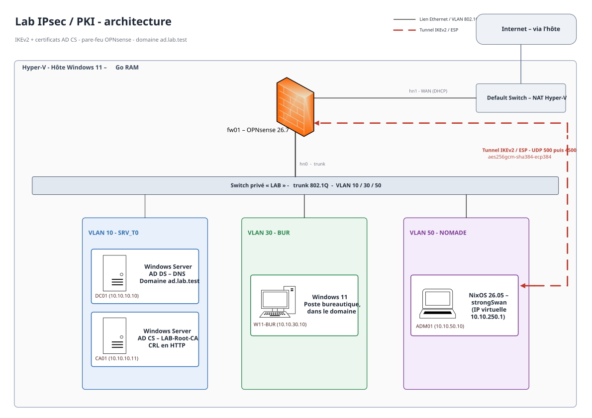

# Lab IPsec / PKI

## Introduction

J'ai monté ce lab pour apprendre à déployer IPsec dans un environnement d'entreprise classique sous Microsoft : un domaine Active Directory, une PKI AD CS et un pare-feu entre les réseaux. Je le partage pour ceux que ça intéresse.

Je parle aussi dans ce repo de la transition post-quantique : où on en est et ce qu'il faut préparer pour garder un niveau de sécurité correct.

## Schéma d'architecture

## Machines du lab

| Hostname | Rôle | OS | RAM | Adresse IP |
|:---------|:-----|:---|----:|:-----------|
| fw01 | Pare-feu, routage inter-VLAN, passerelle IPsec IKEv2 | OPNsense 26.7 | 1 Go | 10.10.10.1 / 10.10.30.1 / 10.10.50.1 (+ WAN en DHCP) |
| DC01 | Contrôleur de domaine AD DS, DNS (`ad.lab.test`) | Windows Server | 2 Go | 10.10.10.10 |
| CA01 | Autorité de certification racine AD CS, CRL en HTTP (IIS) | Windows Server | 2 Go | 10.10.10.11 |
| W11-BUR | Poste bureautique dans le domaine | Windows 11 | 4 Go | 10.10.30.10 |
| ADM01 | Poste d'administration et client VPN strongSwan | NixOS 26.05 | 2 Go | 10.10.50.10 (IP VPN 10.10.250.1) |

Le tout tourne sur un hôte Hyper-V sous Windows 11 et 16 Go de RAM.

## Ce que j'ai appris

- Définir les flux réseau dont chaque service a besoin et n'ouvrir que le nécessaire.
- Monter un tunnel IKEv2 entre OPNsense et strongSwan avec une authentification par certificats et les algorithmes de chiffrement et d'échange de clés  recommandés.
- Comprendre ce qui se passe vraiment sur le réseau en lisant le tunnel paquet par paquet dans Wireshark.
- Comprendre pourquoi un ordinateur quantique menacera RSA et les courbes elliptiques et pourquoi le trafic chiffré aujourd'hui est déjà concerné.
- Préparer l'hybridation avec ML-KEM. La démonstration viendra plus tard.

## Ordre de lecture du repo

Pour comprendre :

1. [Cours IPsec](docs/01-cours-ipsec.md) : IKEv2, ESP, SA, PFS, NAT-T
2. [Cours PKI](docs/02-cours-pki.md) : CA, modèles de certificats, CRL
3. [Architecture](docs/03-architecture.md) : VLAN, plan d'adressage, matrice de flux
4. [Analyse de la capture](docs/04-capture-wireshark.md) : le tunnel vu dans Wireshark
5. [Post-quantique](docs/05-post-quantique.md) : la fiche ANSSI et l'état actuel
6. [Clé de sécurité](docs/06-yubikey.md) : usage de clé matérielle de sécurité

## Limites et suite

- Dans ce lab, la clé privée du poste d'administration est un simple fichier. La version avec la clé sur une YubiKey est documentée dans [docs/06-yubikey.md](docs/06-yubikey.md).
- Prochaines étapes : la démonstration de l'échange de clés hybride avec ML-KEM.
