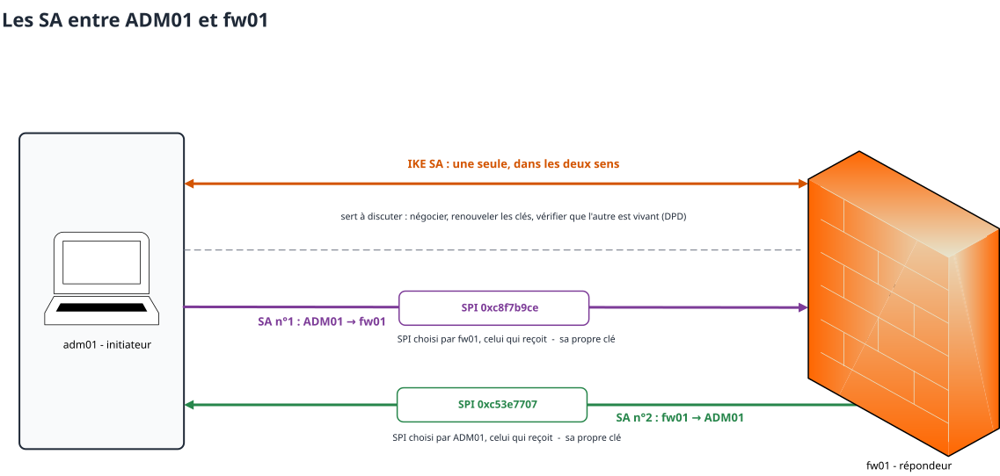
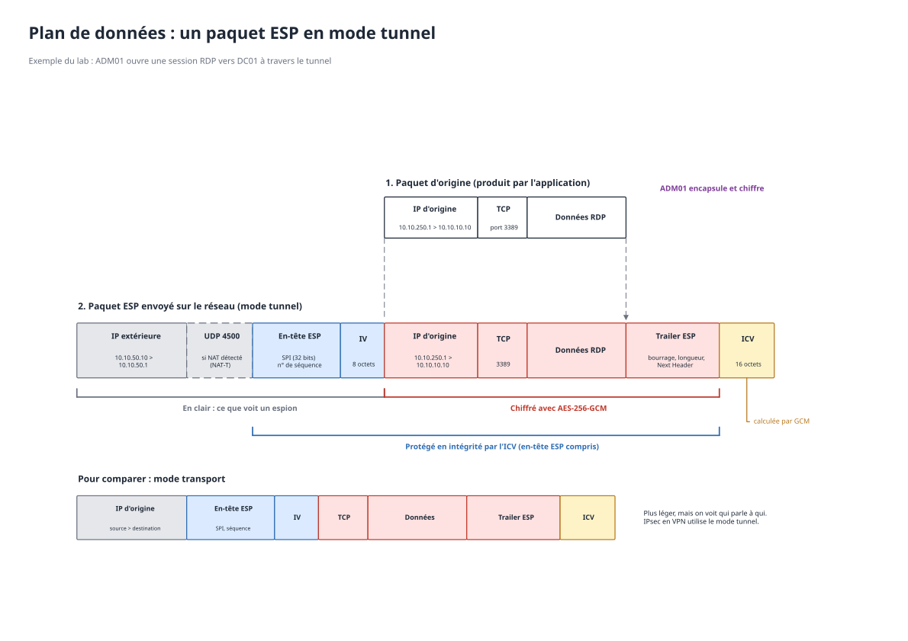

# Cours IPsec

## Introduction

Dans ce cours, je vais vous expliquer rapidement ce que j'ai compris sur l'IPsec et ce dont vous avez besoin pour comprendre le lab. Je prends les exemples du lab : **ADM01** (le poste d'admin) monte un tunnel vers **fw01** (le pare-feu) --> puis fait du RDP sur **DC01**.


## A quoi sert l'IPsec ?

Il sert à **protéger les paquets IP** transitant d'un point à un autre **quel que soit le protocole transporté**. C'est ce qui fait sa force et sa difficulté. Il travaille sur la **couche réseau (couche 3)** du modèle OSI, donc sous UDP et TCP, ce qui fait que les applications ne le voient pas.

IPsec est une architecture qui repose sur **2 étages** :
  1. **Plan de contrôle (IKE : Internet Key Exchange)** : tourne en UDP 500 (puis UDP 4500). Il sert à authentifier les deux pairs --> négocier les algorithmes cryptographiques --> établir les secrets partagés, le tout regroupé dans une structure qui s'appelle une **association de sécurité** (SA).
  2. **Plan des données (ESP ou AH)** : ils protègent les paquets avec les algos et les clés négociés par IKE. Là **tout est en symétrique** (AES-GCM dans le lab) donc c'est rapide. Et c'est le noyau qui fait le boulot pas le logiciel VPN.


## AH et ESP

Les deux protocoles de transfert :
  - **AH** : il assure **l'intégrité** des paquets et **l'authentification**. Il calcule un code d'intégrité (HMAC) sur chaque paquet, ce qui permet de vérifier qu'il n'a pas été modifié et qu'il vient bien du bon pair. Par contre **il ne chiffre rien**.
  - **ESP** : il fait ce que AH fait + il assure **la confidentialité**.

> [!NOTE]
> En pratique AH n'existe plus car il ne chiffre pas et il est incompatible avec le NAT qu'on retrouve quasiment partout aujourd'hui. On ne retrouvera quasiment que de l'**ESP**.

**Pourquoi AH est incompatible avec le NAT ?** AH assure l'intégrité du paquet en entier **y compris l'en-tête IP**. Le NAT lui, réécrit les adresses de l'en-tête IP --> donc à l'arrivée l'intégrité casse et le paquet est jeté.


## Les Security Associations (SA)

Ce sont des genres de contrats qui spécifient les propriétés de sécurité que les deux hôtes respectent quand ils communiquent. **Ils sont à sens unique, donc un par sens**. Elle contient :
  - le **protocole** (ESP ou AH) ;
  - les **algos et les clés** ;
  - le **SPI** (Security Parameter Index) : une valeur sur 32 bits **choisie par le destinataire**. C'est un index en gros quand un paquet arrive --> le destinataire regarde le SPI et sait direct quelle SA (donc quelle clé) utiliser ;
  - le **compteur de séquence** et la **fenêtre anti-rejeu** ;
  - une **durée de vie** (après cette durée on renouvelle les clés) ;
  - le **sélecteur de trafic** qui sert à dire "je veux passer par tel réseau, ou sous-réseau" (par exemple `10.10.10.0/24`).

Pour un échange dans les deux sens, on a donc **une SA par sens**, car :
1. Chaque sens a son propre compteur de séquence et sa fenêtre anti-rejeu.
2. Chaque sens a ses propres clés.
3. Le SPI est choisi par le destinataire. Par exemple, un pare-feu qui reçoit les paquets de 100 postes doit pouvoir garantir que chaque SA entrante a un SPI unique. Donc c'est lui qui les choisit et les annonce à chaque poste.

> [!IMPORTANT]
> Les deux machines connaissent **les deux SA** : une pour envoyer et une pour recevoir. Et à côté il y a une **IKE SA** dans les deux sens et elle sert à IKE pour discuter.




## IKEv2 : le plan de contrôle

IKEv2 établit le tunnel en **2 échanges** : **IKE_SA_INIT** puis **IKE_AUTH**. Ensuite viennent **CREATE_CHILD_SA** et les **INFORMATIONAL**.

### IKE_SA_INIT (en clair)

La machine qui initie propose les algorithmes cryptographiques, et l'autre **en choisit un**. Chacun envoie :
  - **SA** : les algos proposés (ou celui retenu) ;
  - **KE** : la partie publique du Diffie-Hellman ;
  - **Nonce** : de l'aléa.

**Le Diffie-Hellman en gros :** on se met d'accord sur un groupe et son générateur $`g`$. Chacun tire un secret de son côté ($`a`$ et $`b`$), et envoie $`g^a`$ et $`g^b`$ à l'autre. Ensuite chacun combine la partie publique de l'autre avec son secret :

```math
(g^b)^a = (g^a)^b = g^{ab}
```

Les deux ont le même secret $`g^{ab}`$ et **il n'est jamais passé sur le réseau**. Quelqu'un qui écoute voit $`g^a`$ et $`g^b`$ mais il ne peut pas retrouver $`a`$ ou $`b`$ (c'est le **problème du logarithme discret**). Dans le lab c'est une courbe elliptique (ECP-384) mais c'est le même principe.

Les **nonces**, eux sont **publics**. Chacun tire le sien et l'envoie --> donc à la fin les deux connaissent $`N_i`$ et $`N_r`$. Ils servent à ce que chaque session ait des clés différentes même si un jour le DH est réutilisé.

> C'est le **premier moment** où on fait de l'asymétrique.

### IKE_AUTH (chiffré)

On envoie tout ce qui est information d'authentification : les **identités**, les **certificats**, et un champ **AUTH** qui est une **signature faite avec la clé privée**. Le tout chiffré avec les clés dérivées du secret DH.

La signature porte sur les messages d'IKE_SA_INIT et sur le nonce de l'autre. Ce qui fait que :
  - elle **lie le DH à l'identité** --> donc un attaquant ne peut pas se mettre au milieu ;
  - une vieille signature **ne peut pas être rejouée** --> car le nonce change à chaque fois.

Et comme c'est chiffré **les identités ne sont pas visibles sur le réseau**. Cet échange crée aussi la **première Child SA** (la paire de SA ESP) et donne au client son IP dans le pool VPN.

> C'est le **deuxième moment** où on fait de l'asymétrique.

### Ensuite

  - **CREATE_CHILD_SA** : renouvelle les clés avant la fin de leur durée de vie. Il peut refaire un DH, et c'est ça la **PFS** (Perfect Forward Secrecy) : si une clé fuite un jour, les anciennes sessions restent protégées.
  - **INFORMATIONAL** : les messages de service du genre : vérifier que l'autre est toujours là (**DPD**), signaler une erreur, ou fermer le tunnel (**DELETE**).

### Les méthodes d'authentification

IKEv2 accepte plusieurs méthodes :
  - **clé partagée (PSK)** : simple mais c'est la même clé partout --> donc faut la distribuer et la protéger ;
  - **signature numérique avec certificat** : c'est ce qu'on utilise dans le lab. La clé privée peut être stockée sur une YubiKey, et dans ce cas elle n'en sort jamais ;
  - **EAP** : l'utilisateur s'authentifie auprès d'un serveur (RADIUS...).


## Comment les clés sont calculées

**Aucune clé symétrique ne passe sur le réseau.** Les deux machines les calculent chacune de leur côté avec les mêmes éléments en suivant les étapes définies par la **RFC 7296 (section 2.14)**.

On utilise une **PRF** (fonction pseudo-aléatoire). En gros c'est un hachage avec une clé. Dans le lab c'est HMAC-SHA-384.

**1.** Le DH donne $`g^{ab}`$ des deux côtés.

**2.** On calcule la graine :

```math
\text{SKEYSEED} = \text{prf}\left(N_i \,|\, N_r,\; g^{ab}\right)
```

**3.** On la déroule pour obtenir un flux qu'on découpe en 7 clés :

```math
\{SK_d \,|\, SK_{ai} \,|\, SK_{ar} \,|\, SK_{ei} \,|\, SK_{er} \,|\, SK_{pi} \,|\, SK_{pr}\} = \text{prf+}\left(\text{SKEYSEED},\; N_i \,|\, N_r \,|\, SPI_i \,|\, SPI_r\right)
```

  - $`SK_d`$ : sert **uniquement à fabriquer les clés des Child SA** (elle ne chiffre rien elle-même) ;
  - $`SK_{ai}`$ / $`SK_{ar}`$ : intégrité des messages IKE (une par sens) ;
  - $`SK_{ei}`$ / $`SK_{er}`$ : chiffrement des messages IKE (une par sens) ;
  - $`SK_{pi}`$ / $`SK_{pr}`$ : calcul du champ AUTH (une par sens).

**4.** Pour la Child SA, on découpe en une clé AES et un sel **par sens** :

```math
\text{KEYMAT} = \text{prf+}\left(SK_d,\; N_i \,|\, N_r\right)
```

> [!IMPORTANT]
> Le seul secret ici c'est $`g^{ab}`$. Les nonces et les SPI passent en clair.


## Le plan de données



### Mode tunnel et mode transport

  - **Mode tunnel** : on chiffre le paquet d'origine **en entier avec les en-têtes IP** et on le met dans un nouveau paquet IP qui va d'une machine VPN à l'autre. Sur le réseau on voit juste "ADM01 parle à fw01", la vraie destination (DC01) et le protocole (RDP) sont cachés. C'est ce qu'on utilise pour un VPN et dans le lab.
  - **Mode transport** : on garde l'en-tête IP d'origine et on chiffre seulement ce qu'il y a dedans. C'est plus léger mais **on voit qui parle à qui**. Ça sert surtout entre deux hôtes.

### Ce qu'il y a dans un paquet ESP

  - **IP extérieure** : de passerelle à passerelle, c'est tout ce qu'on voit sur le réseau.
  - **UDP 4500** : seulement si un NAT a été détecté pendant IKE_SA_INIT (**NAT-T**). ESP n'a pas de ports donc le NAT ne sait pas le traduire du coup on le met dans de l'UDP.
  - **SPI** : pour que le destinataire retrouve la bonne SA.
  - **Numéro de séquence** : il augmente à chaque paquet (ça sert à l'anti-rejeu).
  - **IV** : change à chaque paquet + le sel = le nonce d'AES-GCM.
  - **Données chiffrées** : le paquet d'origine complet + un trailer (bourrage, longueur, type du contenu).
  - **ICV** : le code d'intégrité (16 octets, c'est le "16" de `aes256gcm16`). Il couvre l'en-tête ESP et les données chiffrées.

### Ce que fait le destinataire

1. Il lit le **SPI** --> il retrouve la SA, donc la clé.
2. Il vérifie le **numéro de séquence** dans la fenêtre anti-rejeu. Un doublon ou un paquet trop vieux --> il le jette.
3. Il vérifie l'**ICV**. Si elle est fausse --> le paquet est jeté **sans même être déchiffré**.
4. Il **déchiffre** et enlève le trailer.
5. Il **remet** le paquet d'origine dans sa pile réseau et les règles du pare-feu s'appliquent.
