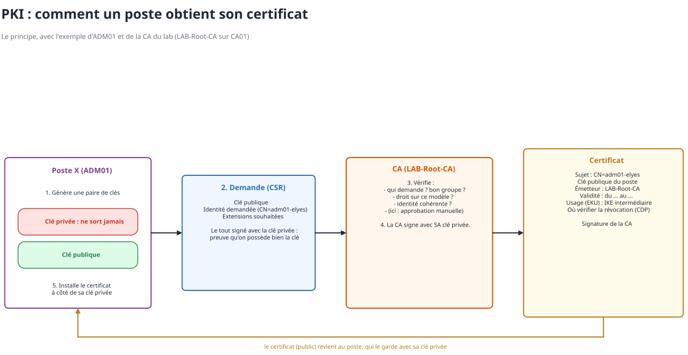
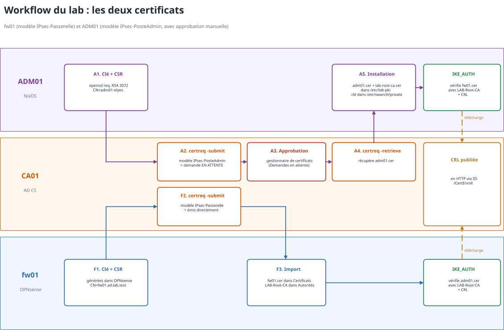

# Cours PKI et certificats

## Le problème de départ

En crypto asymétrique, on dispose d'une **paire de clés** :
  - **privée** --> on la garde en sécurité, elle ne sort jamais de la machine ;
  - **publique** --> on la distribue à qui veut.

Si je signe avec ma clé privée, n'importe qui peut **vérifier ma signature avec ma clé publique**. C'est bien mais maintenant : **comment le pare-feu va savoir que telle clé publique appartient bien à tel poste ?** N'importe qui peut générer une paire de clés et dire "c'est moi ADM01".

La **PKI** (Public Key Infrastructure) répond à ça avec l'**Autorité de Certification (CA)**.

La CA vérifie la demande et ensuite elle signe un document qui dit : *"Telle clé publique appartient bien au poste X, pour l'usage Y, jusqu'au JJ/MM/AAAA"*.

> [!IMPORTANT]
> Le document signé par la CA = **un certificat**.




## Ce qu'il y a dans un certificat

  - **Sujet** : à qui il appartient (ex : `CN=adm01-elyes`) ;
  - **Clé publique** du sujet ;
  - **Émetteur** : qui l'a signé (ex : `LAB-Root-CA`) ;
  - **Validité** : date de début et date de fin ;
  - **Numéro de série** : doit être unique chez la CA --> sert pour la révocation ;
  - **Extensions** : à quoi il sert (**EKU**, Extended Key Usage), noms alternatifs (**SAN**), où vérifier s'il a été révoqué (**CDP**) ;
  - **Signature de la CA** sur tout ça.

La signature en gros : la CA hache le contenu du certificat et signe le résultat avec **sa** clé privée :

```math
\text{signature} = \text{Sign}_{\,\text{privée CA}}\big(\text{H}(\text{contenu du certificat})\big)
```

Pour vérifier, on recalcule le hash et on contrôle la signature avec la **clé publique de la CA**. Si quelqu'un modifie une seule info du certificat (le nom, la date, la clé…) --> la signature ne correspond plus.


## La confiance devient transitive

Pour répondre donc à notre question, le raisonnement devient transitif :
  1. fw01 fait confiance à notre tiers de confiance : la **CA** (il a son certificat) ;
  2. la CA **atteste** que telle clé publique est celle du poste X (elle a signé son certificat) ;
  3. => fw01 fait confiance au certificat du poste X.

Et c'est pareil dans l'autre sens : ADM01 fait confiance à la CA, donc il fait confiance au certificat de fw01.

> [!NOTE]
> Le certificat de la CA **racine** est signé par elle-même (auto-signé). On ne peut pas le "vérifier", on décide de lui faire confiance en l'installant à la main sur chaque machine. C'est le point de départ de toute la chaîne.


## Comment on obtient un certificat ?

1. **On génère une paire de clés** sur la machine qui va utiliser le certificat.
2. **On écrit la demande (CSR)** : elle contient la clé publique, l'identité demandée, les extensions souhaitées, et **on signe tout ça avec la clé privée**. Ça prouve à la CA qu'on possède bien la clé privée qui va avec.
3. **La CA vérifie** : qui demande ? bon groupe ? bons droits sur le modèle ? pour qui ? l'identité est bonne ? Ensuite elle **signe** et **publie** le certificat.
4. **Le certificat est installé là où vit la clé privée.**

> La clé privée ne bouge pas, c'est seulement la CSR qui transite.

## La révocation (CRL)

Un certificat est valable jusqu'à sa date de fin. Mais si un poste est volé ou qu'une clé fuite il faut pouvoir l'**annuler avant**.

La CA tient une **liste de révocation (CRL)** : la liste des numéros de série des certificats annulés signée par la CA. Elle la publie à une adresse indiquée dans chaque certificat (le **CDP**). Quand une machine vérifie un certificat elle télécharge la CRL et regarde si le numéro de série est dedans.

> [!WARNING]
> Si la CRL est injoignable la machine ne peut pas savoir si le certificat est révoqué. Selon la config, elle refuse la connexion ou elle accepte quand même.


## La PKI du lab

### La CA : LAB-Root-CA sur CA01

  - **AD CS** (Active Directory Certificate Services) installé sur **CA01** (`10.10.10.11`) en mode graphique pour bien comprendre chaque étape ;
  - une **CA racine d'entreprise** : elle est intégrée à l'Active Directory, ce qui permet d'utiliser des **modèles de certificats** et de gérer les droits par groupe ;
  - la **CRL est publiée en HTTP** via IIS (répertoire virtuel `CertEnroll`) pour que fw01 et ADM01 qui ne sont pas membres du domaine, puissent la télécharger.

> [!NOTE]
> En entreprise on ne fait pas comme ça : la CA racine est **hors ligne** (éteinte, dans un coffre) et c'est une CA intermédiaire qui signe les certificats au quotidien. Si l'intermédiaire est compromise --> on la révoque et la racine reste saine. Dans le lab une seule CA racine suffit.

### Les deux modèles de certificats

| | **IPsec-Passerelle** | **IPsec-PosteAdmin** |
|:--|:--|:--|
| Pour qui | fw01 | ADM01 |
| Usages (EKU) | IKE intermédiaire + authentification serveur | **IKE intermédiaire uniquement** |
| Émission | directe | **approbation manuelle** du gestionnaire de certificats |

### Le certificat de fw01

1. **F1.** Clé et CSR générées **directement dans OPNsense** (Système > Trust > Certificats) avec `CN=fw01.ad.lab.test`. La clé privée ne quitte jamais fw01.
2. **F2.** La CSR est soumise sur CA01 avec `certreq`, modèle **IPsec-Passerelle** --> le certificat est émis directement.
3. **F3.** Le certificat `fw01.cer` est importé dans OPNsense et le certificat de **LAB-Root-CA** dans Système > Trust > Autorités.

### Le certificat d'ADM01

1. **A1.** Clé RSA 3072 et CSR générées sur ADM01 avec `openssl`, `CN=adm01-elyes`.
2. **A2.** La CSR est soumise sur CA01 avec `certreq`, modèle **IPsec-PosteAdmin** --> la demande reste **en attente**.
3. **A3.** Un admin l'**approuve** dans la console de l'autorité de certification (Demandes en attente).
4. **A4.** On récupère le certificat avec `certreq -retrieve`.
5. **A5.** `adm01.cer` et le certificat de la CA vont dans `/etc/lab-pki` et la clé est accessible à strongSwan dans `/etc/swanctl/private`.



### Et pendant IKE_AUTH ?

Chacun envoie son certificat et l'autre vérifie :
  1. la **signature** du certificat avec la clé publique de LAB-Root-CA ;
  2. les **dates de validité** ;
  3. l'**usage** (EKU) ;
  4. l'**identité** attendue (fw01 n'accepte que `CN=adm01-elyes`, ADM01 n'accepte que `fw01.ad.lab.test`) ;
  5. la **révocation**, en téléchargeant la CRL.

Puis il vérifie le champ AUTH avec la clé publique contenue dans le certificat : ça prouve que l'autre possède bien la clé privée qui va avec.
