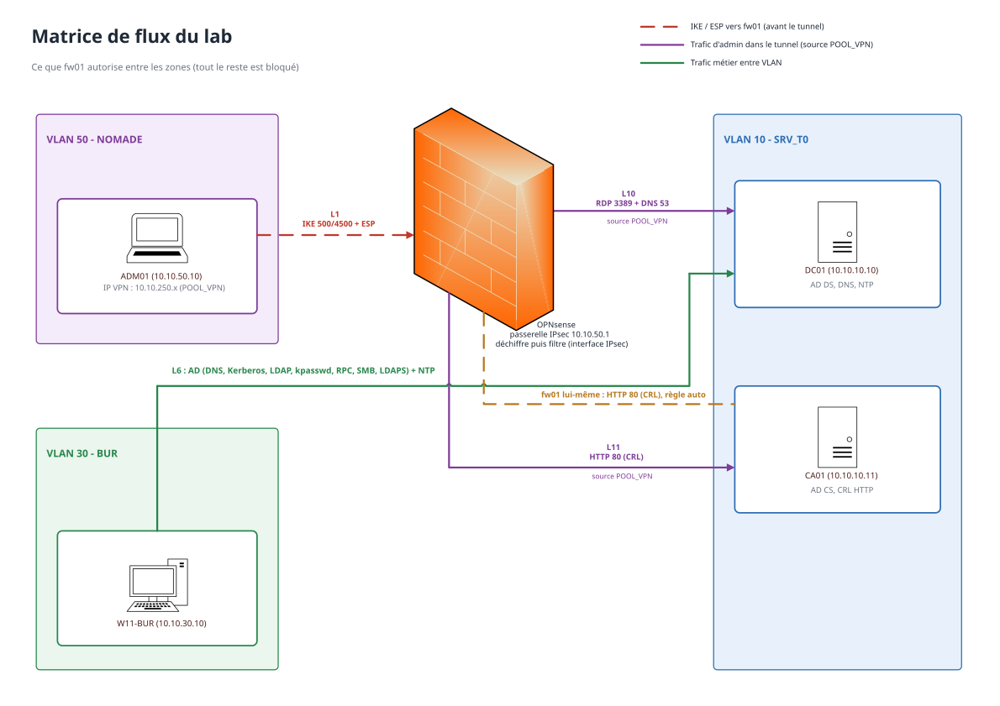

# Architecture du lab

## Vue d'ensemble

Tout le lab tourne sur un seul hôte **Hyper-V** (Windows 11, 16 Go de RAM). Les VM sont branchées sur un switch privé "LAB" en trunk 802.1Q, et c'est **fw01 (OPNsense)** qui fait le routage entre les VLAN et le filtrage. Pour sortir sur Internet : fw01 a une deuxième carte sur le Default Switch d'Hyper-V (NAT).

## Plan d'adressage

| VLAN | Nom | Réseau | Passerelle (fw01) | Machines |
|:-----|:----|:-------|:------------------|:---------|
| 10 | SRV_T0 | `10.10.10.0/24` | `10.10.10.1` | DC01 (.10), CA01 (.11) |
| 30 | BUR | `10.10.30.0/24` | `10.10.30.1` | W11-BUR (.10) |
| 50 | NOMADE | `10.10.50.0/24` | `10.10.50.1` | ADM01 (.10) |
| - | POOL_VPN | `10.10.250.0/24` | - | IP donnée à ADM01 quand le tunnel est monté |
| - | WAN | DHCP | - | sortie Internet de fw01 |

Pourquoi ce découpage ?
  - **SRV_T0** : c'est le tier 0, en gros tout ce qui contrôle le domaine (le DC, la CA). C'est la zone la plus sensible donc personne n'y rentre sans raison.
  - **BUR** : les postes bureautiques. Ils ont besoin de l'AD pour fonctionner mais ils n'administrent rien.
  - **NOMADE** : le poste d'admin (comme s'il était dehors (voir plus bas)).

> [!NOTE]
> Le POOL_VPN c'est un réseau à part. Quand ADM01 passe par le tunnel, son trafic n'arrive pas avec son IP 10.10.50.10 mais avec une IP du pool. Ce qui fait que sur fw01 on peut écrire des règles qui concernent **uniquement le trafic passé par le tunnel**.

## Pourquoi un VLAN NOMADE séparé ?

Le but c'est de simuler un poste d'admin qui serait à l'extérieur (télétravail, déplacement...), sans avoir à monter un vrai accès Internet.

Depuis NOMADE, ADM01 ne peut rien faire à part parler à fw01 en IKE et en ESP (règle L1). Pour aller sur DC01, il est **obligé** de monter le tunnel --> donc de s'authentifier avec son certificat. Et une fois dans le tunnel --> il n'a accès qu'à ce que la règle L10 autorise.

## La matrice de flux

Tout ce qui n'est pas autorisé est bloqué. Chaque ligne = une règle sur fw01 (la colonne "Règle" reprend la description dans OPNsense).

| Règle | Interface | Source | Destination | Protocole | Port(s) | Pourquoi |
|:------|:----------|:-------|:------------|:----------|:--------|:---------|
| L1 | NOMADE | ADM01 | fw01 (NOMADE) | UDP | 500, 4500 (`IKE`) | négociation IKEv2 puis NAT-T |
| L1 | NOMADE | ADM01 | fw01 (NOMADE) | ESP | - | les paquets chiffrés du tunnel |
| L6 | BUR | W11 | DC01 | TCP/UDP | 53, 88, 389, 464 (`AD_TCPUDP`) | DNS, Kerberos, LDAP, changement de mdp |
| L6 | BUR | W11 | DC01 | TCP | 135, 445, 636, 49152-65535 (`AD_TCP`) | RPC, SMB (GPO), LDAPS, RPC dynamique |
| L6 | BUR | W11 | DC01 | UDP | 123 | NTP (sans l'heure, Kerberos marche pas) |
| L10 | IPsec | POOL_VPN | DC01 | TCP | 3389 | RDP d'admin, **seulement via le tunnel** |
| L10 | IPsec | POOL_VPN | DC01 | UDP | 53 | DNS dans le tunnel |
| L11 | IPsec | POOL_VPN | CA01 | TCP | 80 | ADM01 télécharge la CRL de LAB-Root-CA pour vérifier le certificat de fw01 |
| - | (auto) | fw01 | CA01 | TCP | 80 | fw01 télécharge la CRL pour vérifier le certificat d'ADM01 |

## Pourquoi OPNsense ?

  - Gratuit, open source, et ça ressemble à un vrai pare-feu d'entreprise : interfaces, VLAN, alias, règles par interface, IPsec, logs.
  - **Une règle = un protocole + un port (ou un alias de ports).** Au début c'est relou, on peut pas mettre "TCP 3389 + UDP 53" dans la même règle. Mais du coup chaque ligne de la matrice de flux devient une règle et on sait exactement ce qui est ouvert et pourquoi.
  - **Les alias** : on nomme les choses une fois (DC01, POOL_VPN, AD_TCP, IKE...), et les règles deviennent lisibles.
  - Les descriptions des règles reprennent le numéro de la matrice (L1, L6, L10, L11) donc on fait le lien direct entre la doc et la config.

## La config IPsec sur fw01

| Paramètre | Valeur |
|:----------|:-------|
| Version | IKEv2 |
| Propositions | `aes256gcm16-sha384-ecp384` (DH 20, courbe NIST P-384) |
| Adresse locale | `10.10.50.1` (fw01 côté NOMADE) |
| Adresse distante | vide, fw01 attend et c'est ADM01 qui initie |
| MOBIKE | activé |
| DPD | 30 s |
| Pool | `pool-adm` (10.10.250.0/24, DNS 10.10.10.10) |
| Authentification locale | certificat, ID `fw01.ad.lab.test` |
| Authentification distante | certificat, ID exact `C=FR, O=Lab, CN=adm01-elyes` |
| Réseaux locaux (Child SA) | `10.10.10.0/24` |

> [!NOTE]
> L'ID distant est exact. strongSwan accepte pas les jokers partiels genre `CN=adm*`. C'est soit l'ID complet, soit `CN=*`. Avec l'ID exact, seul le certificat d'ADM01 peut monter ce tunnel même si la CA a signé d'autres certificats.
