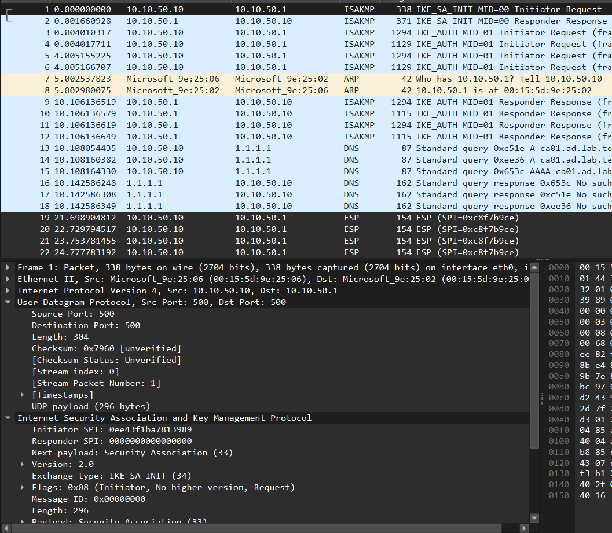
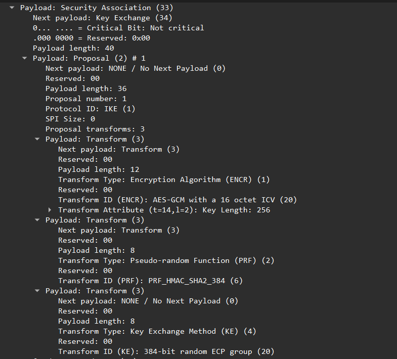
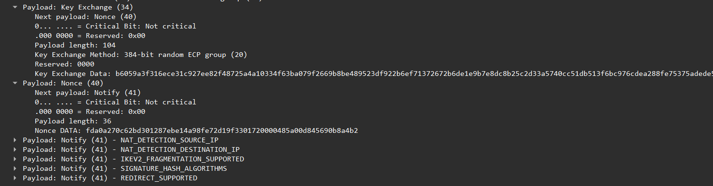
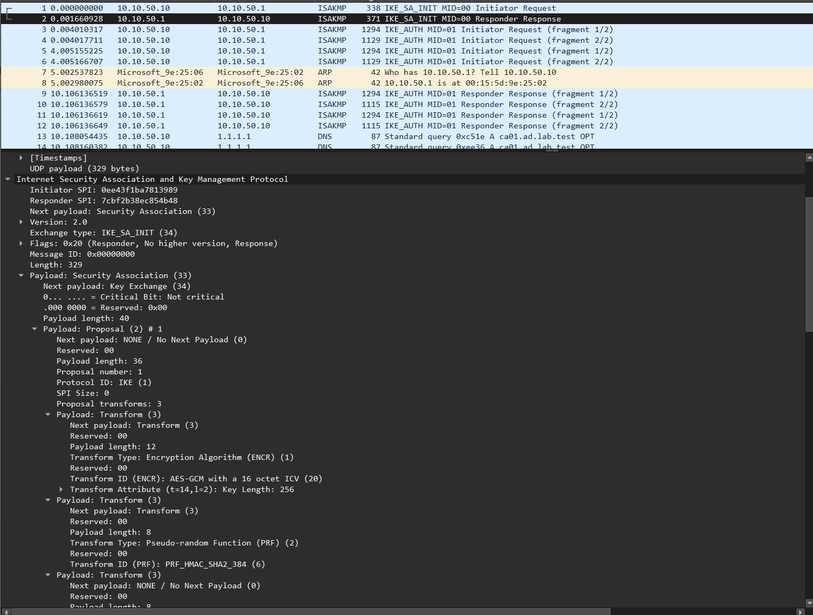
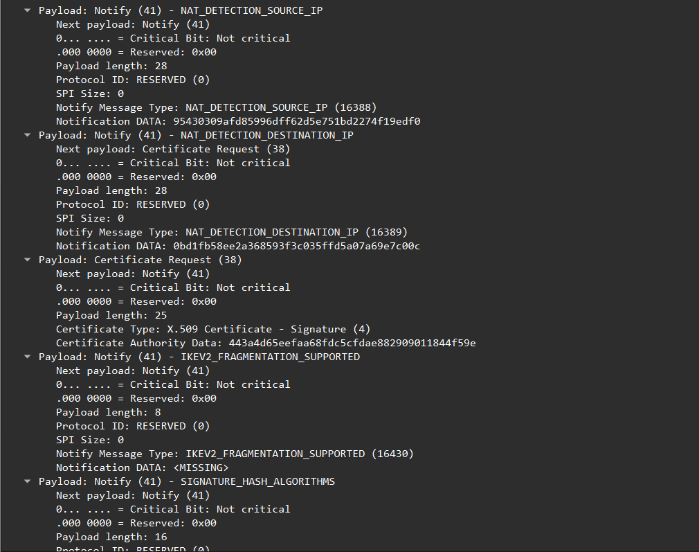
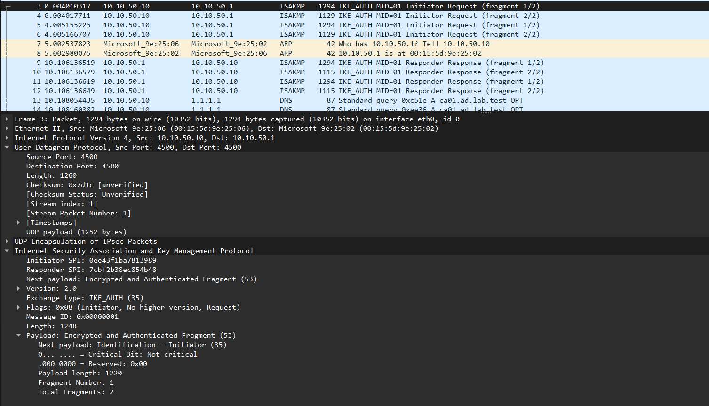
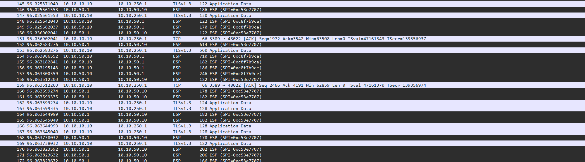

# Le tunnel IPsec vu dans Wireshark

Dans ce document je vais vous montrer concrètement à quoi ressemble un tunnel IPsec : de la création de l'**IKE SA** (négociation des algos, mise en place des clés, échange des certificats) à la création des **Child SA**, et puis le **transport sécurisé des données**.

La capture est faite sur **ADM01** (interface `eth0`) pendant qu'il monte le tunnel vers **fw01** puis ouvre une session RDP sur DC01.

En gros, la capture se lit comme ça :

| Trames | Échange | Port | Ce qui se passe |
|:-------|:--------|:-----|:----------------|
| 1 - 2 | IKE_SA_INIT | UDP 500 | négociation des algos + Diffie-Hellman, **en clair** |
| 3 - 12 | IKE_AUTH | UDP 4500 | identités, certificats, signatures, **chiffré et fragmenté** |
| 13 - 18 | DNS | UDP 53 | ADM01 cherche la CRL de la CA |
| 19 et + | ESP | - | les données, chiffrées dans le tunnel |

## 1. IKE_SA_INIT : la requête d'ADM01 (trame 1)

On commence par notre initiateur, ici : **ADM01**, qui initie sur le **port 500** (`10.10.50.10 --> 10.10.50.1`, UDP 500 --> 500).

Dans la partie **Internet Security Association and Key Management Protocol** on voit :
  - **Initiator SPI** : `0ee43f1ba7813989` --> l'identifiant de l'IKE SA choisi par ADM01 ;
  - **Responder SPI** : `0000000000000000` --> vide car fw01 n'a pas encore répondu donc il n'a pas encore choisi le sien ;
  - **Exchange type** : `IKE_SA_INIT (34)` ;
  - **Message ID** : `0` --> premier échange (on aura `1` pour IKE_AUTH, c'est le `MID=00` / `MID=01` dans la liste).

### La proposition d'algorithmes (payload SA)

Un peu plus bas, on a le payload **Security Association** avec la proposition d'algos d'ADM01. Elle contient 3 transforms :

| Transform | Valeur | Ce que c'est |
|:----------|:-------|:-------------|
| ENCR (1) | `AES-GCM with a 16 octet ICV (20)`, clé 256 bits | chiffrement + intégrité d'IKE |
| PRF (2) | `PRF_HMAC_SHA2_384 (6)` | la fonction qui sert à dériver les clés |
| KE (4) | `384-bit random ECP group (20)` | le groupe Diffie-Hellman (courbe P-384) |

Ce qui donne `aes256gcm16-prfsha384-ecp384` côté config.

### L'échange de clé, le nonce et les notifications

Ensuite on a :
  - **Key Exchange** : la partie publique Diffie-Hellman d'ADM01, en gros le $`g^a`$ dont on a parlé dans le cours. Le payload fait 104 octets, donc 96 octets de données : c'est un point de la courbe P-384 (coordonnées x et y, 48 octets chacune) ;
  - **Nonce** : l'aléa d'ADM01, 32 octets ($`N_i`$) ;
  - des **notifications** :
    - `NAT_DETECTION_SOURCE_IP` et `NAT_DETECTION_DESTINATION_IP` : ce sont des **hashs** de l'IP et du port de chaque côté. fw01 recalcule le hash avec ce qu'il reçoit vraiment et si ça correspond pas c'est qu'un NAT a modifié l'adresse en route ;
    - `IKEV2_FRAGMENTATION_SUPPORTED` : "je sais fragmenter les messages IKE" (on va en avoir besoin pour IKE_AUTH) ;
    - `SIGNATURE_HASH_ALGORITHMS` : les algos de hash acceptés pour les signatures ;
    - `REDIRECT_SUPPORTED` : "je supporte qu'une passerelle me redirige vers une autre".

> [!IMPORTANT]
> Tout ça passe **en clair**. N'importe qui sur le réseau voit les algos, le $`g^a`$ et le nonce. Mais comme on l'a vu, ça suffit pas pour retrouver le secret $`g^{ab}`$.

## 2. IKE_SA_INIT : la réponse de fw01 (trame 2)

Ensuite on a le paquet de réponse de la passerelle :
  - **Responder SPI** : `7cbf2b38ec854b48` --> c'est l'identifiant que **fw01 a choisi de son côté** pour cette IKE SA. Maintenant l'IKE SA est identifiée par le couple des deux SPI ;
  - **Flags** : `Responder` ;
  - le payload **SA** : **l'algo que fw01 a choisi** parmi ceux proposés par ADM01. Ici ADM01 n'en proposait qu'un, donc forcément c'est le même ;
  - son propre **KE** ($`g^b`$) et son propre **Nonce** ($`N_r`$).

Et dans ses notifications, fw01 renvoie aussi les **NAT_DETECTION** (calculés de son côté) et il rajoute un truc important :
  - **Certificate Request (CERTREQ)** : en gros fw01 dit "envoie-moi ton certificat, et il doit être signé par **cette** CA". Le champ `Certificate Authority Data` c'est le hash de la clé publique de la CA en qui fw01 a confiance --> **LAB-Root-CA**.

> [!Note]
> À la fin de ces 2 trames, les deux machines ont tout ce qu'il faut ($`g^{ab}`$, $`N_i`$, $`N_r`$, les deux SPI) pour calculer les clés SK_e, SK_a, SK_p et SK_d. Donc la suite peut être chiffrée.

## 3. IKE_AUTH (trames 3 à 12)

Et puis ensuite on a la partie **IKE_AUTH**. Première chose à voir : on passe sur le **port 4500** (UDP 4500 --> 4500) et Wireshark affiche **UDP Encapsulation of IPsec Packets**. Une fois que NAT-T est négocié --> strongSwan bascule sur 4500 pour toute la suite.

C'est là que passent toutes les informations d'identité, les certificats, et les champs **AUTH** qui sont des signatures faites avec la clé privée de chacun. Mais dans Wireshark on voit rien de tout ça :
  - le payload s'appelle **Encrypted and Authenticated Fragment (53)** : c'est chiffré avec SK_e ;
  - on voit juste `Next payload: Identification - Initiator`, en gros le **type** du premier élément caché à l'intérieur.

Ce qui fait que **les identités (CN=adm01-elyes, fw01.ad.lab.test) ne sont pas visibles sur le réseau**.

Le tout est **fragmenté sur 2 paquets pour chaque pair** (`Fragment Number: 1`, `Total Fragments: 2`). C'est à cause des certificats RSA car avec la chaîne  le message dépasse la taille max d'un paquet (MTU). Donc IKE découpe lui-même le message (RFC7383) plutôt que de laisser IP fragmenter parce que les fragments IP sont souvent jetés par les pare-feux.

Ce message contient aussi la création de la **première Child SA** (les algos ESP et les réseaux du tunnel) et la demande d'IP dans le pool VPN. Pas besoin d'un échange en plus.

> [!WARNING]
> Si on se fie au temps :
>   - trames 3-4 à **t = 0 s** : ADM01 envoie son IKE_AUTH ;
>   - trames 5-6 à **t = 4 s** : pas de réponse --> donc il **retransmet** ;
>   - trames 9-12 à **t = 10,1 s** : fw01 répond enfin (2 fois, une pour chaque envoi).
>
> fw01 met 10 secondes à répondre parce qu'il vérifie le certificat d'ADM01 et notamment la **CRL** qu'il va chercher sur CA01.

## 4. ESP : le transport des données (trames 19 et +)

Et puis quand tout est up le transport des données se fait en **ESP**. On voit deux SPI, un par sens :

| Sens | SPI | Choisi par |
|:-----|:----|:-----------|
| ADM01 --> fw01 | `0xc8f7b9ce` | fw01 (celui qui reçoit) |
| fw01 --> ADM01 | `0xc53e7707` | ADM01 (celui qui reçoit) |

C'est les **deux SA à sens unique** de la Child SA.

Et là on se dit qu'il y a un truc bizarre entre les paquets ESP, on voit passer du **TLSv1.3** et du **TCP 3389** de `10.10.10.10` (DC01) vers `10.10.250.1` (l'IP VPN d'ADM01). C'est la session RDP **déjà déchiffrée**.

En gros, quand ADM01 reçoit un paquet ESP --> le noyau le déchiffre et **réinjecte le paquet d'origine** dans la pile réseau et Wireshark le voit passer une deuxième fois. C'est pour ça qu'on voit chaque paquet en double : la version ESP (`10.10.50.1 --> 10.10.50.10`) puis la version déchiffrée (`10.10.10.10 --> 10.10.250.1`).

> [!NOTE]
> Ce n'est **pas** une fuite, le paquet en clair n'existe qu'à l'intérieur d'ADM01. Sur le réseau, il n'y a que de l'ESP. Pour le prouver, il faudrait capturer côté fw01 sur l'interface NOMADE et on ne verrait que de l'ESP.

Et le contenu RDP est lui-même chiffré en TLS 1.3, donc même déchiffré par IPsec on lit pas les données. C'est deux couches de chiffrement l'une dans l'autre.

## 5. La vie du tunnel

Ensuite, toutes les 30 secondes environ, on voit des échanges **INFORMATIONAL** : c'est le **DPD** (Dead Peer Detection). fw01 demande "t'es toujours là ?", ADM01 répond, et si un jour il répond plus, fw01 coupe le tunnel.

Quand on ferme le tunnel (`swanctl --terminate`) on voit un dernier INFORMATIONAL avec un payload **DELETE** pour la Child SA, puis pour l'IKE SA.
