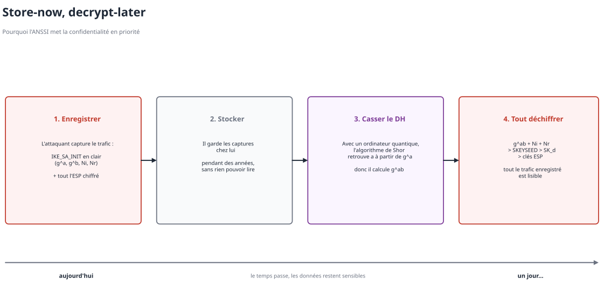
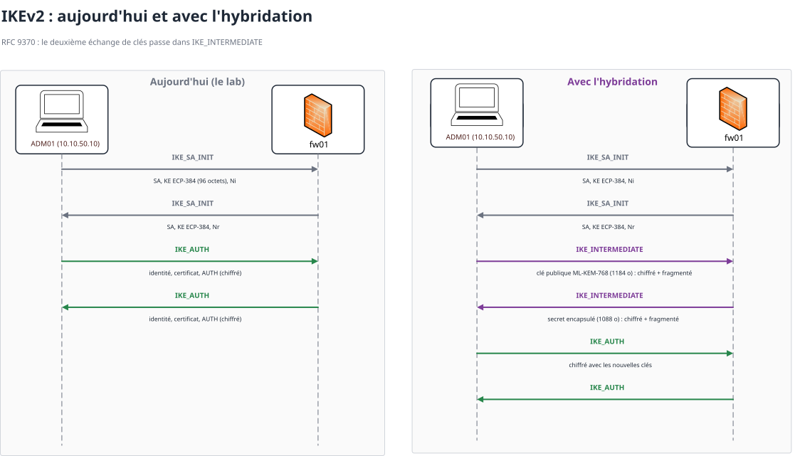

# IPsec et le post-quantique

Je ne me suis pas contenté de faire le lab en IPsec avec de la cryptographie dite "classique", car on sait tous que la menace du quantique plane, et qu'un jour la cryptographie asymétrique sera cassée. Donc je me suis penché sur le sujet côté IPsec, et ça tombe bien car l'ANSSI a documenté cela dans sa fiche technique [Transition post-quantique d'IPsec (ANSSI-FT-117)](https://messervices.cyber.gouv.fr/documents-guides/transition_post_quantique_ipsec.pdf).


## Qu'est-ce qui est menacé dans IPsec ?

Quand on parle de transition du protocole IPsec vers le post-quantique, on parle plus précisément du protocole **IKEv2** qui est basé sur de l'asymétrique : l'initiateur et le répondeur négocient les suites cryptographiques, effectuent les échanges de clés basés sur **Diffie-Hellman**, et s'authentifient mutuellement avec des **signatures**.

Le protocole **ESP** quant à lui est basé sur de la cryptographie **symétrique** (AES) qui est une technologie non menacée directement par le quantique.

> [!IMPORTANT]
> Par contre, les clés d'ESP sont dérivées d'IKEv2. Donc si on casse IKE --> on récupère les clés d'ESP => et on déchiffre tout le trafic.


## Pourquoi la confidentialité passe en priorité ?

Même si c'est encore loin, l'ANSSI dit qu'aujourd'hui la **confidentialité passe en priorité** car on a les attaques **"store-now, decrypt-later"**. Un attaquant pourrait capturer les trames réseau et les stocker chez lui, en attendant le jour où il pourra casser cela. Et une fois que c'est fait, il peut tout déchiffrer.



Pour l'authentification c'est moins urgent car casser une signature dans 10 ans ne permet pas de remonter un tunnel aujourd'hui, l'attaque doit se faire en direct.


## La solution : l'hybridation de l'échange de clés

La vraie solution que l'ANSSI propose c'est l'**hybridation de l'échange de clés**. En gros on fait **deux échanges de clés différents** :
  - un avec un mécanisme **classique** (le DH, ECP-384 dans le lab) dans IKE_SA_INIT ;
  - un autre **post-quantique** comme **ML-KEM**, dans un nouvel échange **IKE_INTERMEDIATE** qui se place entre IKE_SA_INIT et IKE_AUTH.

strongSwan l'implémente déjà à partir de la version 6.0.

Ensuite on combine les deux secrets pour dériver le secret final, qui aura deux couches de sécurité :

```math
\text{secret final} = \text{prf}\big(\,g^{ab}\;,\;K_{\text{ML-KEM}}\,\big)
```

Ce qui fait qu'un attaquant doit casser **les deux** pour retrouver les clés :
  - si l'ordinateur quantique arrive --> le DH tombe, mais ML-KEM tient ;
  - si on trouve un jour une vulnérabilité dans ML-KEM (c'est un algo récent) --> le DH classique tient encore.

  > [!NOTE]
  > Un **KEM** (Key Encapsulation Mechanism) est un mécanisme basé sur un échange asymétrique : l'un envoie sa clé publique, l'autre s'en sert pour "encapsuler" un secret aléatoire et renvoie le résultat, et seul le propriétaire de la clé privée peut le "désencapsuler". À la fin, les deux ont le même secret, comme avec un DH.
  >
  > **ML-KEM** repose sur des problèmes de **réseaux euclidiens**, et aucun algorithme quantique connu à ce jour ne peut le casser.
  
### Pourquoi un échange en plus ?

Parce que les clés post-quantiques sont beaucoup plus grosses. Dans la capture du lab, le KE d'ECP-384 fait **96 octets**. Une clé publique ML-KEM-768 fait **1184 octets** (chiffre du standard FIPS 203).

Sauf que IKE_SA_INIT est **en clair** donc il peut pas être fragmenté par IKE (la fragmentation IKE ne marche que sur les messages chiffrés, RFC 7383). Et la fragmentation IP beaucoup de pare-feux la jettent.

Donc on fait d'abord le DH classique en clair --> ce qui donne des premières clés, et le ML-KEM passe ensuite dans **IKE_INTERMEDIATE** qui est **chiffré** --> **donc fragmentable** (RFC 9242 et RFC 9370).



Pour les renouvellements de clés (CREATE_CHILD_SA) c'est la même idée avec des messages **IKE_FOLLOWUP_KE**.

## Et l'authentification ?

Cependant, l'authentification n'a **pas encore de standard**. Il faudrait des certificats et des signatures hybrides dans IKE_AUTH mais d'après l'ANSSI il n'existe pas encore de standard pour ça dans IKEv2. Donc on attend.


## Et sur le lab ?

  - La proposition actuelle c'est `aes256gcm16-prfsha384-ecp384` : du classique. AES-256 et SHA-384 c'est bon mais l'échange de clés en ECP-384 seul est **exposé au store-now, decrypt-later**.
  - La cible ce serait `aes256gcm16-prfsha384-ecp384-ke1_mlkem768` (`ke1_` = un échange de clés en plus, ML-KEM-768).
  - **ADM01** tourne avec strongSwan 6.1 qui supporte ML-KEM.
  - Sur **fw01**, `swanctl --list-algs` montre bien ML-KEM mais **l'interface web d'OPNsense 26.7 ne permet pas encore de le sélectionner** dans les propositions.

> [!NOTE]
> Le moteur est prêt des deux côtés c'est juste l'interface du pare-feu qui suit pas encore. La démo avec IKE_INTERMEDIATE dans Wireshark viendra plus tard.
