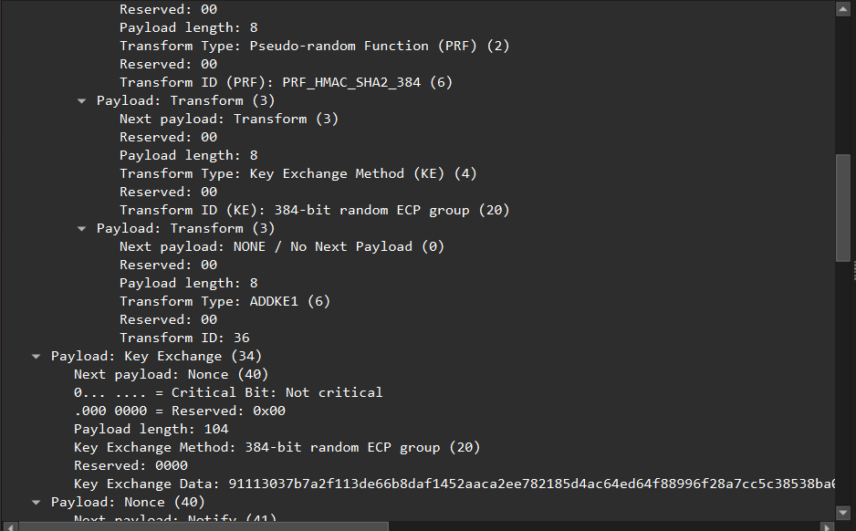
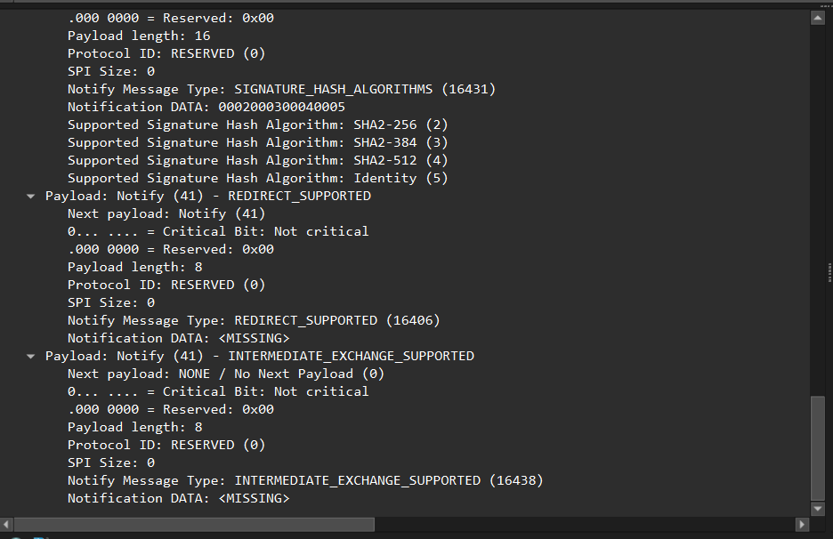
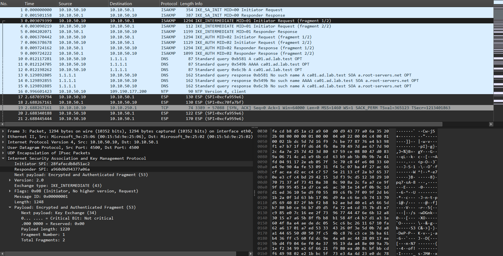
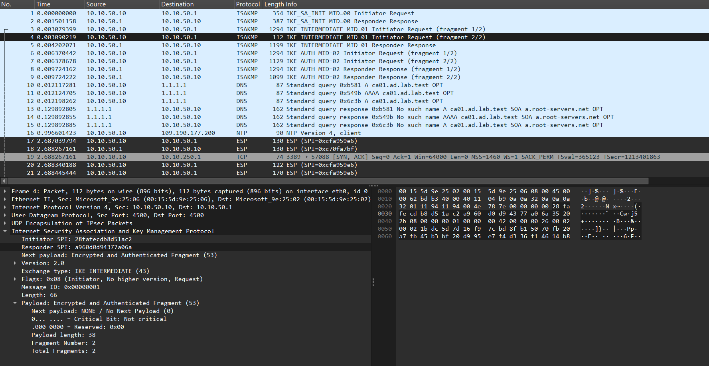
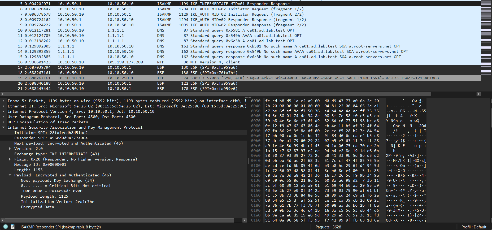
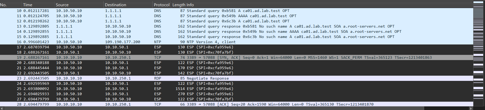

# Démo : l'échange de clés hybride ML-KEM

Comme prévu, j'ai fait la démo de l'**échange de clés hybride** pour IPsec entre **ADM01** (ma machine d'administration NixOS) et **fw01** (la passerelle, pare-feu OPNsense). Ça a très bien fonctionné, et j'ai passé du temps sur la capture Wireshark pour voir la différence avec le tunnel classique.

> [!NOTE]
> Pour comprendre pourquoi on fait ça, lisez d'abord [IPsec et le post-quantique](05-post-quantique.md). Ici c'est la mise en pratique.


## Ce qui change dans la config

### Côté ADM01 (NixOS)

Seulement la proposition IKE :

```nix
# avant
proposals = [ "aes256gcm16-sha384-ecp384" ];

# après : ke1_ = un échange de clés en plus ML-KEM-768
proposals = [ "aes256gcm16-sha384-ecp384-ke1_mlkem768" ];
```

strongSwan 6.1 sait déjà le faire (plugin `ml`)

### Côté fw01 (OPNsense)

Là c'était moins simple. Le strongSwan d'OPNsense supporte ML-KEM (`swanctl --list-algs` le montre bien) mais **l'interface web d'OPNsense 26.7 ne permet pas de le choisir** dans les propositions.

Donc j'ai écrit la connexion à la main dans un fichier `conf.d` que strongSwan charge en plus de la config générée par la GUI (`include conf.d/*.conf` à la fin de `swanctl.conf`) :

```conf
# /usr/local/etc/swanctl/conf.d/lab-pqc.conf
# Connexion IKEv2 hybride : ECP-384 (classique) + ML-KEM-768 (post-quantique)
connections {
  lab-pqc {
    version = 2
    local_addrs = 10.10.50.1
    proposals = aes256gcm16-sha384-ecp384-ke1_mlkem768
    mobike = yes
    dpd_delay = 30
    send_certreq = yes
    pools = pool-adm                     # le pool déjà créé par la GUI
    
    local {
      auth = pubkey
      id = fw01.ad.lab.test
      certs = <certificat-fw01>.crt      # fichier généré par la GUI dans x509/
    }
    remote {
      auth = pubkey
      id = "C=FR,O=Lab,CN=adm01-elyes"
      cacerts = <lab-root-ca>.crt        # fichier généré par la GUI dans x509ca/
    }
    children {
      admin {
        local_ts = 10.10.10.0/24
        esp_proposals = aes256gcm16-ecp384
        mode = tunnel
        dpd_action = clear
      }
    }
  }
}
```

Et l'ancienne connexion de la GUI est **désactivée** pour éviter les conflits.


## Sur Wireshark

### 1. IKE_SA_INIT, ce qui change



Dans la proposition d'algos d'ADM01 on a un transform en plus par rapport au tunnel classique : **`ADDKE1 (6)`, Transform ID `36`**.
  - le type **6** veut dire **"Additional Key Exchange 1"** (RFC 9370) --> c'est le `ke1_` de la config ;
  - l'ID **36** correspond à **ML-KEM-768** dans le registre IANA d'IKEv2.

Juste en dessous le payload **Key Exchange** fait toujours **104 octets** avec `384-bit random ECP group (20)` --> dans IKE_SA_INIT **seul le DH classique passe** çe veut dire que la clé ML-KEM n'est pas là.



Et en bas on a la notification **`INTERMEDIATE_EXCHANGE_SUPPORTED`** qui veut dire "je sais faire l'échange IKE_INTERMEDIATE" (RFC 9242). Il prévient l'autre qu'on va pouvoir faire un échange en plus entre IKE_SA_INIT et IKE_AUTH.

> [!NOTE]
> Donc IKE_SA_INIT s'occupe de l'échange de clés DH et de prévenir qu'on va faire un échange de clés complémentaire en ML-KEM-768.

### 2. IKE_INTERMEDIATE : le ML-KEM



C'est le **nouvel échange** avec `Exchange type: IKE_INTERMEDIATE (43)` et `Message ID: 1`. Dans la listeon a **MID=00** (INIT), **MID=01** (INTERMEDIATE), **MID=02** (AUTH). Avant IKE_AUTH était en MID=01.

On fait l'échange ML-KEM **chiffré avec les clés du DH**. On le voit car le payload s'appelle `Encrypted and Authenticated Fragment (53)` et dedans on voit juste `Next payload: Key Exchange (34)`.



Et les tailles confirment tout :
  - **ADM01 --> fw01** : sa **clé publique ML-KEM** (1184 octets). Ça dépasse un paquet donc c'est **fragmenté** en 2 (1294 + 112 octets) ;
  - **fw01 --> ADM01** : le **secret encapsulé** (1088 octets) et ça tient dans **un seul paquet** (1199 octets).



> [!IMPORTANT]
> C'est exactement ce que dit l'ANSSI : IKE_SA_INIT est en clair --> il **ne peut pas être fragmenté** par IKE + ML-KEM est trop gros pour lui. Alors on fait d'abord le DH qui donne des premières clés, et le ML-KEM passe après dans IKE_INTERMEDIATE qui est chiffré, donc fragmentable.

### 3. Le nouveau SKEYSEED

Ce n'est pas une chose qu'on voit dans Wireshark mais c'est le cœur de l'hybride. Après IKE_INTERMEDIATE le **SKEYSEED change**. Il n'est plus calculé comme avant car maintenant on y ajoute **K** --> le secret ML-KEM (RFC 9370) :

```math
\text{SKEYSEED}' = \text{prf}\big(SK_d,\; K_{\text{ML-KEM}} \,|\, N_i \,|\, N_r\big)
```

Le $`SK_d`$ ici vient du premier calcul donc du DH ($`g^{ab}`$). Et de ce nouveau SKEYSEED on redérive toutes les clés (SK_e, SK_a, SK_p, SK_d) comme d'habitude.

Ce qui fait que :
  - **IKE_AUTH** est chiffré avec des clés qui dépendent **des deux secrets** ;
  - les **clés ESP** sont dérivées du nouveau $`SK_d`$ donc elles aussi ;
  - même si un jour le DH est cassé par un ordinateur quantique, avoir $`g^{ab}`$ ne suffit plus car **il manque K**. Et K on ne peut pas le retrouver avec la clé publique et le chiffré ML-KEM qui sont passés sur le réseau.

### 4. ESP : rien ne change



Ensuite le transport des données se fait en **ESP** avec deux nouveaux SPI (un par sens) et le RDP vers DC01 passe dans le tunnel.

Et le paquet ESP est **exactement le même** qu'en classique : AES-256-GCM avec le même format.

## Ce qui reste classique

  - **L'authentification** : les certificats et les signatures sont toujours en RSA. Comme l'ANSSI dit : il n'existe pas encore de standard pour l'authentification hybride dans IKEv2. C'est moins urgent car une signature doit être cassée en direct et pas après coup.
